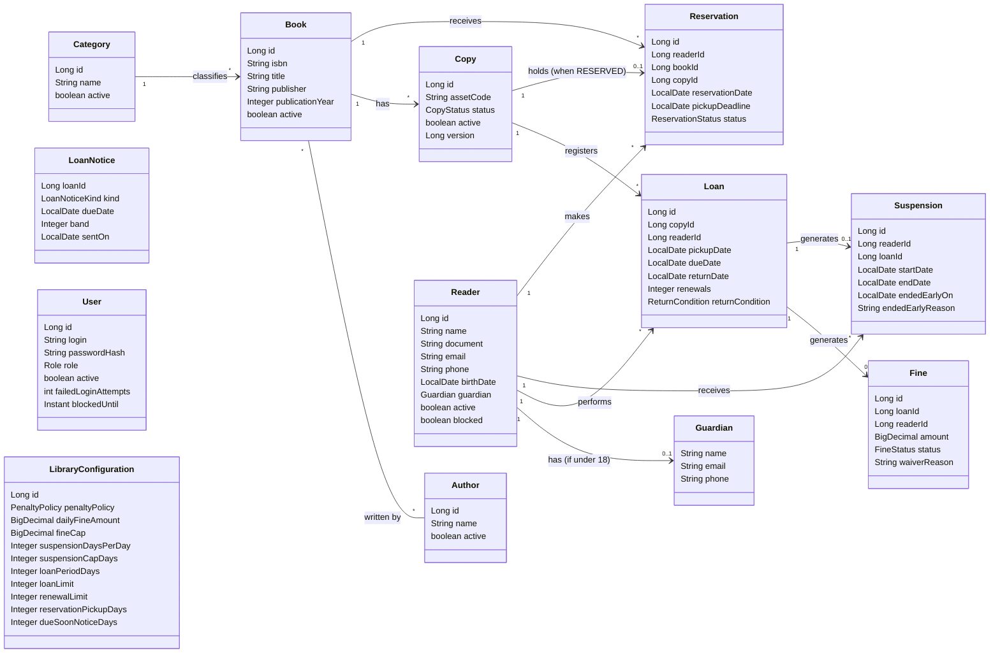

# Books Manager: Diagramas

> Diagrama de classes das entidades de domínio e seus relacionamentos.

## Diagrama de classes

## Enumerações

| Tipo | Valores |
| --- | --- |
| `CopyStatus` | AVAILABLE, BORROWED, RESERVED, DAMAGED, LOST |
| `FineStatus` | PENDING, PAID, WAIVED |
| `ReturnCondition` | GOOD (padrão), DAMAGED, LOST |
| `ReservationStatus` | ACTIVE, FULFILLED, CANCELLED, EXPIRED |
| `Role` | ADMIN, OPERATOR |
| `PenaltyPolicy` | FINE, SUSPENSION, BOTH, NONE |

## Estado de implementação

| Entidade | Módulo | Situação |
| --- | --- | --- |
| `Category`, `Author`, `Book`, `Copy` | `catalog` | Implementadas: domínio, persistência, casos de uso e endpoints REST de cadastro, consulta, listagem, edição e inativação (issues #5–#16, #35–#37 e #43–#58), inclusive a pesquisa de livros com exemplares disponíveis (RF05, issue #83). |
| `Reader` | `user` | Implementado: migração (issue #88), domínio (issue #89), persistência (issue #90) e endpoints REST de cadastro, consulta, listagem, edição, inativação e bloqueio (issues #91 a #96). |
| `User` | `user` | Migração `app_user` (issue #97), domínio (issue #98), persistência (issue #99), administrador inicial (issue #100), autenticação (issues #101 a #105) e criação, consulta, listagem, edição de perfil, desbloqueio, inativação e redefinição de senha de usuário (issues #106 a #110) implementados (fase 2, `docs/projeto.md`). |
| `LibraryConfiguration` | `loan` | Migração (issue #136), domínio, com o enum `PenaltyPolicy` (issue #137), persistência (issue #138) e os endpoints `GET` e `PATCH /api/v1/library-configuration` (issue #139) implementados. |
| `Penalty` e `PenaltyPolicy.calculate` | `loan` | Implementados (issue #140): o cálculo da multa e da suspensão por variante da política. |
| `BorrowingEligibility` e `BorrowingSituation` | `loan` | Implementados (issue #144): as regras que decidem se um leitor pode pegar um exemplar (RN03, RN04, RN05, RN11). |
| `Loan` | `loan` | Implementado (Fase 3): domínio (issue #141), migração e persistência (issues #145 e #146) e os endpoints de registro (`POST /api/v1/loans`, issue #149), devolução (`/{id}/return`, issue #150), renovação (`/{id}/renew`, issue #151), consulta e listagem com o histórico (issue #152) e o relatório de atrasos (`/api/v1/reports/overdue-loans`, issue #157). |
| `Fine` | `loan` | Implementada (Fase 3): domínio, com o enum `FineStatus` (issue #142), migração e persistência (issues #145 e #146) e os endpoints de pagamento e abono (issue #153) e de listagem (`GET /api/v1/fines`, issue #154). |
| `Suspension` | `loan` | Implementada (Fase 3): domínio (issue #143), migração e persistência (issues #145 e #146) e os endpoints de listagem (issue #154) e de encerramento antecipado (`POST /api/v1/suspensions/{id}/end`, issue #155). A suspensão é um registro do `loan`, não um campo do `Reader` (decisão da issue #135). |
| `Reservation` | `loan` | Implementada (Fase 4): domínio (issue #188), com o ciclo de vida `ACTIVE` para `FULFILLED`, `CANCELLED` ou `EXPIRED`; elegibilidade para reservar (`ReservationEligibility` e `ReservationSituation`, issue #189); migração `V10` e persistência (issue #190); `POST /api/v1/reservations` (#192), consultas (`GET /api/v1/reservations` e `/{id}`, #193), cancelamento (`POST /{id}/cancel`, #197), a fila na devolução (#194), a retirada do exemplar guardado (`CopyHold`, #196) e a expiração automática (#198 e #199). Guarda o leitor, o livro e, quando segura um exemplar, o exemplar e o prazo de retirada; esperar na fila ou segurar um exemplar é derivado do exemplar, não guardado. |
| `ReturnCondition` | `loan` | Implementada (Fase 4, RF15, issues #184 a #187): condição do exemplar na devolução (`GOOD`, `DAMAGED`, `LOST`), guardada no `Loan`; um exemplar danificado ou perdido nunca volta a disponível nem entra na fila. |
| `CopyHold` | `loan` | Implementado (issue #196): se o exemplar está guardado para uma reserva e para quem (`NONE`, `FOR_THIS_READER`, `FOR_THIS_READER_PAST_DEADLINE`, `FOR_ANOTHER_READER`); é o fato da `BorrowingSituation` que abre a exceção da RN03 só para o dono da reserva, dentro do prazo (inclusivo). |

## Referências

Atributos, descrição textual e relacionamentos de cada entidade: `docs/projeto.md`, seção "Modelo de domínio". Requisitos e regras de negócio relacionados: `docs/requisitos.md`.
