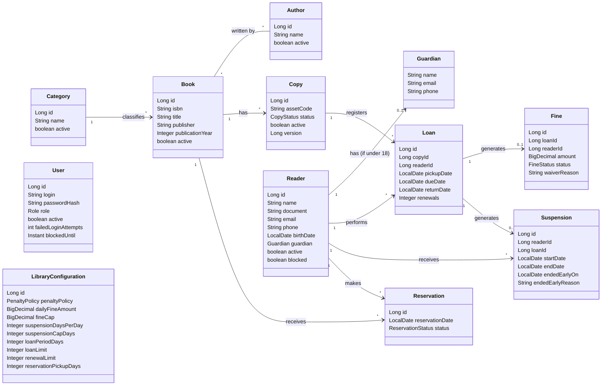

# Books Manager: Diagramas

> Diagrama de classes das entidades de domínio e seus relacionamentos.

## Diagrama de classes

## Enumerações

| Tipo | Valores |
| --- | --- |
| `CopyStatus` | AVAILABLE, BORROWED, RESERVED, DAMAGED, LOST |
| `FineStatus` | PENDING, PAID, WAIVED |
| `ReservationStatus` | ACTIVE, FULFILLED, CANCELLED, EXPIRED |
| `Role` | ADMIN, OPERATOR |
| `PenaltyPolicy` | FINE, SUSPENSION, BOTH, NONE |

## Estado de implementação

| Entidade | Módulo | Situação |
| --- | --- | --- |
| `Category`, `Author`, `Book`, `Copy` | `catalog` | Implementadas: domínio, persistência, casos de uso e endpoints REST de cadastro, consulta, listagem, edição e inativação (issues #5–#16, #35–#37 e #43–#58), inclusive a pesquisa de livros com exemplares disponíveis (RF05, issue #83). |
| `Reader` | `user` | Implementado: migração (issue #88), domínio (issue #89), persistência (issue #90) e endpoints REST de cadastro, consulta, listagem, edição, inativação e bloqueio (issues #91 a #96). |
| `User` | `user` | Migração `app_user` (issue #97), domínio (issue #98), persistência (issue #99), administrador inicial (issue #100), autenticação (issues #101 a #105) e criação, consulta, listagem, edição de perfil, desbloqueio, inativação e redefinição de senha de usuário (issues #106 a #110) implementados (fase 2, `docs/projeto.md`). |
| `LibraryConfiguration` | `loan` | Migração (issue #136), domínio, com o enum `PenaltyPolicy` (issue #137), persistência (issue #138) e os endpoints `GET` e `PATCH /api/v1/library-configuration` (issue #139) implementados. |
| `Penalty` e `PenaltyPolicy.calculate` | `loan` | Implementados (issue #140): o cálculo da multa e da suspensão por variante da política. |
| `Loan`, `Fine`, `Suspension` | `loan` | Planejadas — fase 3 do plano de desenvolvimento (issues #141 a #157). A suspensão é um registro do `loan`, não um campo do `Reader` (decisão da issue #135). |
| `Reservation` | `loan` | Planejada — fase 4 do plano de desenvolvimento. |

## Referências

Atributos, descrição textual e relacionamentos de cada entidade: `docs/projeto.md`, seção "Modelo de domínio". Requisitos e regras de negócio relacionados: `docs/requisitos.md`.
