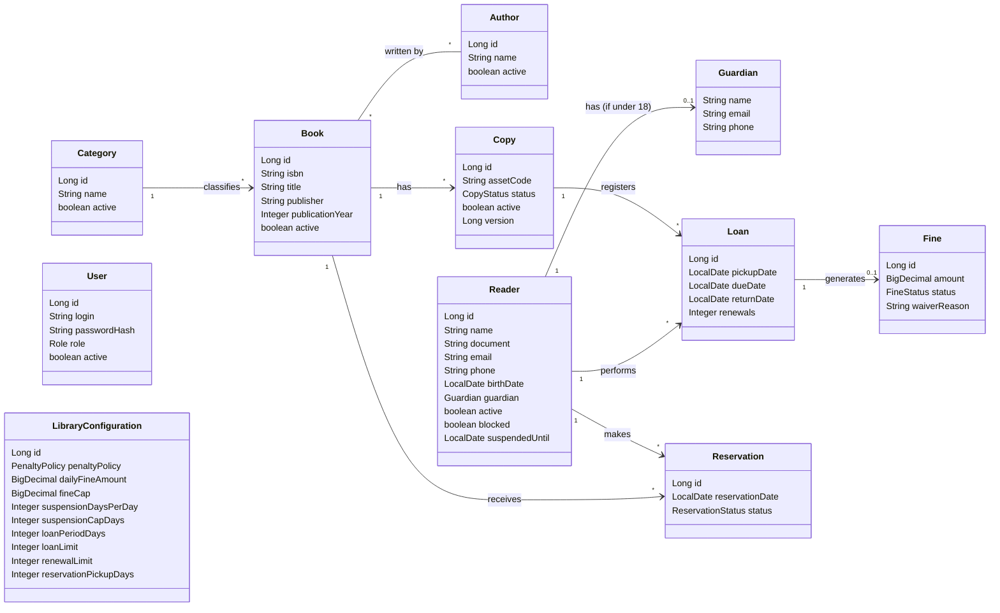

# Books Manager: Diagramas

> Diagrama de classes das entidades de domínio e seus relacionamentos.

## Diagrama de classes

## Enumerações

| Tipo | Valores |
| --- | --- |
| `CopyStatus` | AVAILABLE, BORROWED, RESERVED, DAMAGED, LOST |
| `FineStatus` | PENDING, PAID, WAIVED |
| `ReservationStatus` | ACTIVE, FULFILLED, CANCELLED, EXPIRED |
| `Role` | ADMIN, OPERATOR |
| `PenaltyPolicy` | FINE, SUSPENSION, BOTH, NONE |

## Estado de implementação

| Entidade | Módulo | Situação |
| --- | --- | --- |
| `Category`, `Author`, `Book`, `Copy` | `catalog` | Implementadas: domínio, persistência, casos de uso e endpoints REST de cadastro, consulta, listagem, edição e inativação (issues #5–#16, #35–#37 e #43–#58), inclusive a pesquisa de livros com exemplares disponíveis (RF05, issue #83). |
| `Reader` | `user` | Domínio implementado (issue #89), com a migração `reader` (issue #88); faltam persistência, casos de uso e endpoints (fase 2, `docs/projeto.md`). |
| `User` | `user` | Planejada — fase 2 do plano de desenvolvimento (`docs/projeto.md`). |
| `Loan`, `Fine`, `Reservation`, `LibraryConfiguration` | `loan` | Planejadas — fases 3 e 4 do plano de desenvolvimento. |

## Referências

Atributos, descrição textual e relacionamentos de cada entidade: `docs/projeto.md`, seção "Modelo de domínio". Requisitos e regras de negócio relacionados: `docs/requisitos.md`.
